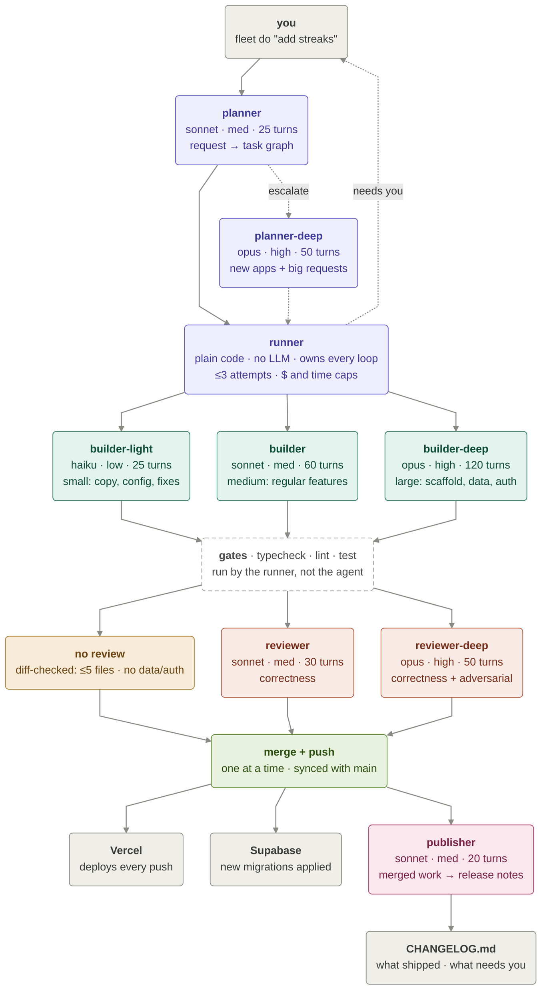

# agent-fleet-kit (AFK)

One sentence in; a tested, merged and deployed feature out. AFK plans the work,
builds it with parallel Claude agents, tests and reviews it, then merges,
deploys and writes the changelog while you're away from the keyboard.

- **Code runs the loop, not a model.** The runner runs the tests itself, so "done" means green.
- **Cheapest model that works.** Haiku, Sonnet or Opus by task size; retries stay on the same model.
- **Bounded.** Attempts, dollars and minutes are capped; stuck work comes back to you with the reason.

## How it works

Dashed: escalation or a question for you. Red gates or blocking findings send
the task back to the same builder (≤3 attempts); a stronger model joins only
on the last one.



## Install

Needs Node 18+, git and [Claude Code](https://claude.com/claude-code), signed in.

```bash
git clone https://github.com/neil-mithipati/agent-fleet-kit.git ~/agent-fleet-kit
cd ~/agent-fleet-kit && npm link
```

**Database + deploys (optional, once per machine).** `fleet connect` uses your
own Supabase and Vercel logins:

```bash
brew install supabase/tap/supabase && supabase login
npm i -g vercel && vercel login
```

Then run `fleet connect` once per app. It:

- creates and links a Supabase project (`--region`, default `us-east-1`; `--org <id>` if you have several orgs)
- links a Vercel project to the app's GitHub repo, so every push deploys
- writes the Supabase URL, public key and database password to `.env.local` (gitignored, never readable by agents) and sets the public ones on Vercel

From then on, merged migrations are applied to Supabase automatically
(`"db_push": "manual"` in `.fleet/config.json` turns that off).

## Use

**New app**

```bash
fleet init ~/code/habits && cd ~/code/habits
git remote add origin <empty GitHub repo url>   # auto-push + deploys
fleet connect                                   # creates Supabase + Vercel projects, writes .env.local
fleet do "Build a habit tracker: daily check-offs and streaks"
```

**Existing repo:** `cd my-app && fleet init && fleet do "..."` (adds `.fleet/` and `CHANGELOG.md` only).

New apps default to TypeScript, React + Vite, Supabase (+ Auth), Tailwind,
Vitest and ESLint on Vercel, unless your request names a stack.

| command | |
|---|---|
| `fleet do "<request>"` | plan, build, test, review, merge, deploy |
| `fleet do` | resume after a stop, crash or retry |
| `fleet status [id]` | what's running, shipped, or needs you |
| `fleet retry <id> "answer"` | unblock a task, then `fleet do` |
| `fleet connect` | link Supabase + Vercel (once per app) |
| `fleet stop` | pause; work resumes later |

Live view: http://127.0.0.1:4777. Settings: `.fleet/config.json`.
Design: [ARCHITECTURE.md](ARCHITECTURE.md).
