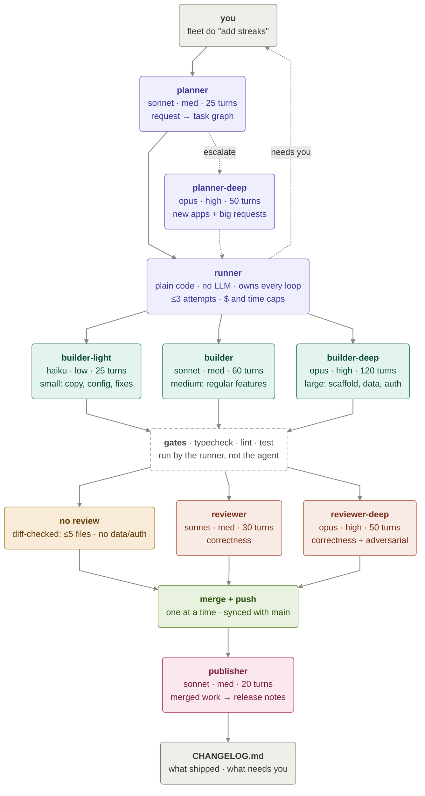

# agent-fleet-kit (AFK)

Describe a feature in one sentence. A fleet of Claude agents plans it, builds
it in parallel, tests it, reviews it, merges it and writes the changelog,
while you're away from the keyboard.

- **Trust comes from the runner, not the agent.** Plain code runs the loop and
  the tests, so "done" means the gates actually passed.
- **The right model for each task.** Haiku for small fixes, Sonnet for
  features, Opus only for large or stuck work.
- **Bounded by design.** Every retry, dollar and minute has a cap. No endless
  loops; anything stuck comes back to you with the reason.

## How it works

solid: main path · dashed: escalation or a question for you · red gates or
blocking review findings go back to the **same** builder (≤3 attempts); a
stronger tier only on the last one; lint/typecheck fixes go to haiku.



Every agent is a single `claude -p` call that returns JSON; the runner decides
what happens next. Agents never push, rewrite history or read secrets.
Details: [ARCHITECTURE.md](ARCHITECTURE.md).

## Install and use

Requires Node 18+, git and the [Claude Code](https://claude.com/claude-code) CLI, signed in.

```bash
git clone https://github.com/neil-mithipati/agent-fleet-kit.git ~/agent-fleet-kit
cd ~/agent-fleet-kit && npm link        # puts `fleet` on your PATH, no dependencies
```

**New app**

```bash
fleet init ~/code/habit-tracker && cd ~/code/habit-tracker
fleet do "Build a habit tracker: add habits, check them off daily, show streaks"
```

**Existing repo** (adds `.fleet/` and `CHANGELOG.md`, touches nothing else)

```bash
cd ~/code/my-app && fleet init
fleet do "Streaks should survive a missed weekend day"
```

Watch it live at http://127.0.0.1:4777. Read what shipped in `CHANGELOG.md`.

| command | what it does |
|---|---|
| `fleet do "<request>"` | Plan, build, test, review, merge, push |
| `fleet do` | Resume after a stop, crash or retry |
| `fleet status [id]` | What's running, what shipped, what needs you |
| `fleet retry <id> "answer"` | Unblock a task, then `fleet do` |
| `fleet stop` | Pause; in-flight work resumes later |

New apps default to **TypeScript, React + Vite, Supabase (+ Auth), Tailwind,
Vitest and ESLint, deployed on Vercel**, unless your request names another
stack. Change the default, models, limits, parallelism and auto-push in
`.fleet/config.json`.
